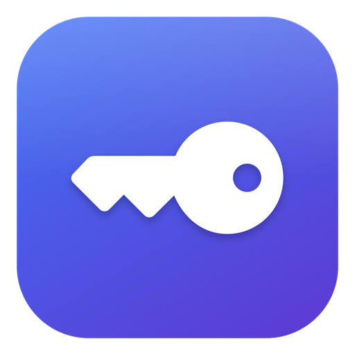

<p align="center"></p>

# Alfred LAPS

An [Alfred 6](https://www.alfredapp.com) workflow for looking up **LAPS passwords from Active Directory**. It supports Windows LAPS (encrypted and cleartext) and legacy Microsoft LAPS.

It uses Alfred 6's native **Alfred UI**: results show up inside Alfred's own window, so you can type `laps PC123`, press ↩, and the password is on your clipboard. The lookups are done by the bundled [laps-cli](https://github.com/jankkm/laps-cli).

## Features

- **Look up in one keystroke.** Look up one computer or several (`laps PC1, PC2`). A Universal Action also works on any selected hostname.
- **Detailed results.** Each result shows the password in a monospaced font, the managed account, the LAPS type, when the password rotates, and when it was last set. Passwords that are about to expire are highlighted.
- **Five ways to use a password:**
  - copy it
  - paste it into the frontmost app
  - **auto-type** it (for VM consoles, RDP and KVM windows that don't accept paste)
  - show it in Large Type
  - refresh the lookup
- **Recent lookups.** With an empty field you see your recent lookups. Only computer names are stored, never passwords.
- **Readable errors.** You get clear messages for "not found", "no permission", "wrong password" and "can't reach the DC / are you on the VPN?".

### Security

- Your AD password is stored **only in the macOS Keychain** (item *Alfred LAPS*). It is checked against Active Directory before it is saved.
- The password reaches `laps-cli` through the environment, never through command-line arguments.
- Copied passwords are marked **transient**, so Alfred's Clipboard History skips them. You can also have them cleared from the clipboard automatically after 30 seconds to 5 minutes.
- Nothing is logged.

## Installation

1. Download the latest `Alfred-LAPS-*.alfredworkflow` from [Releases](../../releases) and double-click it.
2. In *Configure Workflow*, enter your **AD domain** and **user**. Optional settings are the domain controller, search base, CA certificate and StartTLS.
3. Type `laps`. On first use you'll be asked for your AD password, which is then stored in your Keychain.

Requirements: Alfred 6 with Powerpack, on macOS (Apple silicon or Intel). Your account needs read access to the LAPS attributes. Encrypted Windows LAPS passwords also require membership in the decryption group, which is *Domain Admins* by default.

## Usage

| Input | |
|---|---|
| `laps PC123` | Look up a computer |
| `laps PC1, PC2 PC3` | Look up several computers |
| Universal Action **Get LAPS Password** | Look up the selected text |

| Key | Action |
|---|---|
| ↩ | Look up the typed name, then **copy** the selected password |
| ⌘↩ | Paste into the frontmost app |
| ⌘T | Auto-type into the frontmost app |
| ⌘L / ⌥↩ | Show in Large Type |
| ⌘R | Look up again |
| ⌘, | Change or forget the saved AD password |
| ↑ ↓ | Move between results |

**Auto-type** needs Alfred to have *Accessibility* permission (System Settings › Privacy & Security › Accessibility). You can set the typing speed, and whether Return is pressed afterwards, in *Configure Workflow*. Characters are sent as key presses, so the target machine's keyboard layout should match your Mac's.

Other workflows or scripts can open the lookup through the external trigger `lookup`:

```applescript
tell application id "com.runningwithcrayons.Alfred" to run trigger "lookup" in workflow "jankkm.alfred-laps" with argument "PC123"
```

## Development

The workflow is a plain Alfred workflow folder:

```
info.plist              Alfred objects, wiring and user configuration
icon.png
laps.alfredui/
  ui.json               Alfred UI window definition
  components/           header, results list, footer, shortcuts, events
  scripts/laps          JXA controller: Keychain, laps-cli, JSON UI actions
laps-cli                not in git; downloaded at release time
```

To work on it locally:
1. Clone the repo into `Alfred.alfredpreferences/workflows/`, or symlink it there.
2. Put a `laps-cli` binary from the [laps-cli releases](https://github.com/jankkm/laps-cli/releases) next to `info.plist`.

`prefs.plist` holds your personal configuration and is git-ignored.

### Releases

Pushing a tag like `v1.2.0` runs [`.github/workflows/release.yml`](.github/workflows/release.yml). It:

1. downloads the macOS arm64 and amd64 builds of `laps-cli` (version pinned in `LAPS_CLI_VERSION`), checks them against `SHA256SUMS`, and merges them into one universal binary
2. sets the workflow version from the tag
3. packages `Alfred-LAPS-v1.2.0.alfredworkflow` and attaches it to a new GitHub release

```sh
git tag v1.2.0 && git push origin v1.2.0
```
